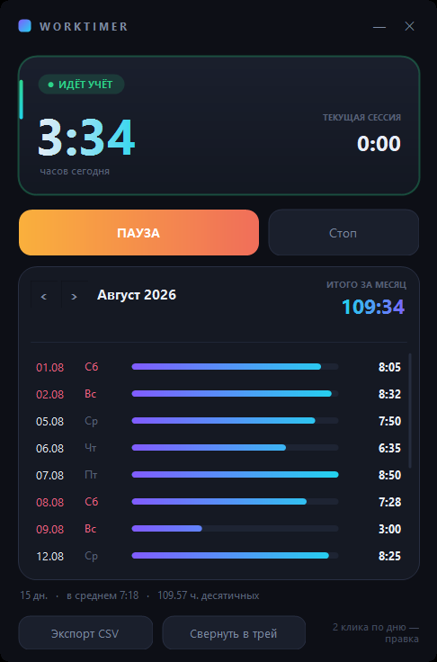
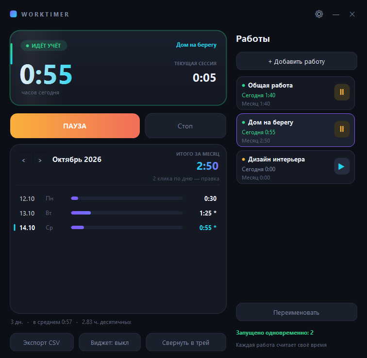

<div align="center">

# ⏱ WorkTimer

**Трекер рабочих часов для Windows и Linux, который живёт в трее.**
Нажал «Старт» — считает. В конце месяца показывает итог по дням и отдаёт CSV для табеля.

### [⬇ Скачать WorkTimer.exe](https://github.com/shhmft/WorkTimer/releases/latest/download/WorkTimer.exe)




</div>

---

## Зачем

Считать отработанные часы, не открывая ничего лишнего. Windows-версия запускается
без установки, часы хранятся локально. Интернет используется для проверки и скачивания обновлений.

## Возможности

|  | |
|---|---|
| ▶ **Старт / Пауза / Стоп** | из окна или прямо из меню трея |
| 🗂 **Работы с названиями** | отдельные часы и история для каждого проекта; несколько таймеров могут идти одновременно |
| 🎨 **Иконка меняет цвет** | зелёная — идёт учёт, оранжевая — пауза, серая — стоп |
| 📅 **Итог по дням и за месяц** | с мини-барами, средним за день и часами в десятичном виде |
| ✏️ **Ручная правка** | двойной клик по дню: `7:30`, `7.5` или `450m` |
| 🪟 **Плавающий виджет** | полупрозрачная плашка поверх окон — время, прогресс до 8 часов, кнопка паузы |
| 📤 **Экспорт CSV** | за любой период — календарь с выбором двух дат |
| ⌨️ **Ctrl + Alt + Space** | глобальный старт и пауза, не отрывая рук |
| ⚙️ **Настройки** | виджет, его прозрачность, горячая клавиша, автозапуск |
| 🚀 **Автозапуск с Windows** | галочка в меню трея |
| 💾 **Данные не теряются** | автосохранение каждые 15 секунд во время учёта |
| 🔄 **Обновления с GitHub** | первая автоматическая проверка при запуске, далее не чаще раза в 24 часа; скачивание после подтверждения и проверка SHA-256 |
| 🌙 **Полностью тёмный интерфейс** | безрамочное скруглённое окно, всё нарисовано вручную |

## Установка

Скачай [`WorkTimer.exe`](https://github.com/shhmft/WorkTimer/releases/latest/download/WorkTimer.exe)
из [последнего релиза](https://github.com/shhmft/WorkTimer/releases/latest) и запусти. Всё.

Никакого инсталлятора и рантайма — программа работает на .NET Framework 4,
который уже встроен в каждую Windows.

Для Linux скачай `.deb` из [последнего релиза](https://github.com/shhmft/WorkTimer/releases/latest)
и следуй [инструкции по установке](linux/README.md).

## Как пользоваться

- **Левый клик** по иконке в трее — показать или спрятать окно
- **Правый клик** — меню: Старт / Пауза / Стоп, папка с данными, автозапуск, выход
- **Наведение** — подсказка вида `Идёт учёт • сегодня 6:42`
- **Пауза** — на обед, потом «Продолжить». **Стоп** — сессия закрыта, часы за день остаются
- Крестик прячет окно в трей, а не закрывает программу
- Окно таскается за верхнюю полосу, список дней крутится колесом

### Раздельный учёт по работам

Нажми **«+ Добавить работу»** и введи название проекта, клиента или задачи.
Справа появится карточка с часами за сегодня и за выбранный месяц. Нажатие на карточку
показывает её таймер и историю по дням; кнопка ▶ / Ⅱ запускает и приостанавливает эту работу.

Можно запускать несколько работ одновременно: переключение между карточками,
пауза или стоп одной работы не останавливают остальные. В каждой работе учитывается
весь её интервал, поэтому параллельный час прибавит по часу каждой запущенной работе.
В меню трея есть управление каждой работой и **«Пауза всех работ»**.

Ручная правка, экспорт CSV, виджет и Ctrl + Alt + Space относятся к выбранной работе.
Название выбранной работы видно в основном окне и в виджете. Названия можно менять
кнопкой **«Переименовать»**, часы сохраняются. Старые записи находятся в **«Общей работе»**.
После перезапуска восстанавливаются работы, часы и выбор; таймеры ждут нового запуска.



## Плавающий виджет


Маленькая полупрозрачная плашка поверх всех окон: время за сегодня, текущая сессия
и полоска прогресса до 8 часов. Пока идёт учёт, точка слева дышит зелёным.

- **Перетаскивается** мышью в любое место, позиция запоминается
- **Кнопка справа** — старт и пауза, не открывая окно
- **Двойной клик** — открыть основное окно, **правый клик** — меню
- **Стрелочка справа сверху** раскрывает ползунок прозрачности — тянешь влево-вправо
- **Включается и выключается** кнопкой «Виджет» в окне, в настройках или в меню трея

## Где лежат данные

```
%APPDATA%\WorkTimer\
├─ sessions.csv    отрезки времени: начало|конец|ID работы (ISO)
├─ adjustments.csv ручные правки: дата|минуты|ID работы
├─ projects.csv    работы: ID|название в Base64 UTF-8
└─ settings.ini    состояние и позиция виджета
```

Обычный текст — можно открыть, поправить, забрать с собой.
Работа через полночь корректно делится между двумя днями.
Записи старого формата без ID работы автоматически относятся к «Общей работе».
Windows и Linux используют одинаковый формат: для переноса истории скопируй
`sessions.csv`, `adjustments.csv` и `projects.csv`. Настройки виджета и автозапуска
зависят от платформы.

Данные пишутся каждые 15 секунд, а также при выключении компьютера, уходе в сон,
блокировке экрана и выходе из программы — при штатном завершении Windows не теряется
ничего.

## Обновления

Таймер проверяет последний стабильный **GitHub Release** при запуске и затем
не чаще раза в сутки. Обычный коммит или тег без опубликованного релиза обновлением
не считается. В меню трея есть **«Проверить обновления»**, а автоматическую проверку
можно отключить там же или в настройках. Проверка обращается только к публичному
репозиторию `shhmft/WorkTimer`, вход в GitHub не нужен. Для учёта часов интернет не требуется.

Новая версия скачивается в фоне после подтверждения. Перед установкой проверяются
размер и SHA-256 из метаданных релиза; повреждённый файл не устанавливается.
В Windows приложение сохраняет часы, закрывается, заменяет `.exe` и запускается
снова. Активные работы возобновляют учёт после запуска; время перезапуска не прибавляется.
Прежний `.exe` остаётся рядом как `WorkTimer.exe.previous`, а при неудачном запуске
нового файла таймер пытается восстановить прежний. Папка с `.exe` должна быть доступна для записи.

В Linux скачивается `.deb`. При наличии `pkexec` и `apt-get` таймер предлагает
системную установку с подтверждением администратора и затем перезапуск.
Если этих средств нет, он показывает команду установки скачанного файла через `sudo apt install`.
Часы и работы хранятся отдельно от программы.

## Сборка из исходника

```cmd
build.cmd
```

Файлы `WorkTimer.cs`, `Updater.cs` и `icon.ico`; компилятор `csc.exe` уже есть в Windows.
Исходники должны быть в **UTF-8**; скрипты сборки явно задают кодировку компилятора.

Проверка независимых таймеров, старых данных, сохранения, перезапуска, полуночи и CSV:

```powershell
powershell -NoProfile -ExecutionPolicy Bypass -File tests/run.ps1
powershell -NoProfile -ExecutionPolicy Bypass -File tests/run-updater.ps1
```

Проверки используют временную папку и не меняют пользовательские данные.

GitHub Actions проверяет и собирает обе платформы. После объединения изменений в `main` и отправки тега `v1.4.1`
после успешных проверок создаётся релиз с `WorkTimer.exe` и `worktimer_1.4.1_all.deb`.
Для следующего релиза обнови версии в исходниках, скрипте пакета и workflow;
приложения найдут опубликованные файлы и их контрольные суммы через API GitHub.

## Лицензия

MIT — делай что хочешь.
