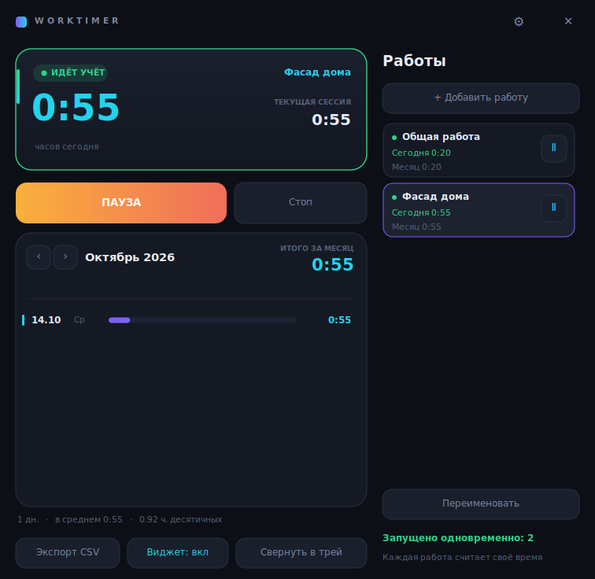

# WorkTimer для Linux

Порт windows-версии на Python 3 + GTK 3. Рисование через Cairo, поэтому вид
почти совпадает с оригиналом: та же тёмная карточка, полоски по дням, виджет.

## Установка

Версия исходников — **1.4.2**. Скачай `.deb` из [релизов](https://github.com/shhmft/WorkTimer/releases)
или собери пакет из исходников по инструкции ниже. Для пакета 1.4.2 выполни:

```bash
sudo apt install ./worktimer_1.4.2_all.deb
```

`apt` сам подтянет зависимости. Если ставить через `dpkg -i`, зависимости
придётся доставить руками:

```bash
sudo dpkg -i worktimer_1.4.2_all.deb
sudo apt -f install
```

Зависимости: `python3`, `python3-gi`, `python3-gi-cairo`, `gir1.2-gtk-3.0`.
Рекомендуется `gir1.2-ayatanaappindicator3-0.1` — без неё значок в лотке
показывается старым механизмом `Gtk.StatusIcon`, который в GNOME не виден.

Запуск: из меню приложений или командой `worktimer`.

## Отличия от windows-версии

| | Windows | Linux |
|---|---|---|
| Данные | `%APPDATA%\WorkTimer` | `~/.local/share/worktimer` |
| Настройки | там же | `~/.config/worktimer/settings.ini` |
| Автозапуск | ключ реестра | `~/.config/autostart/worktimer.desktop` |
| Горячая клавиша | своя, `Ctrl+Alt+Space` | назначается в параметрах системы |

Формат файлов одинаковый, данные переносятся копированием `sessions.csv`,
`adjustments.csv` и `projects.csv`. Старые записи без ID работы попадут в «Общую работу».

## Работы и параллельные таймеры

Нажми «+ Добавить работу» и введи название проекта, клиента или задачи.
Карточка справа показывает время за сегодня и за выбранный месяц; ▶ / Ⅱ управляет
таймером этой работы. Нажатие на название выбирает её историю и основной таймер.
Несколько работ можно запускать одновременно. Пауза, стоп и переключение одной
работы не останавливают остальные. Параллельный час учитывается целиком у каждой
запущенной работы.

В меню трея есть запуск и пауза по работам и «Пауза всех работ». Виджет, ручная правка,
CSV и `worktimer --toggle` относятся к выбранной работе. Переименование сохраняет
историю. После перезапуска работы, выбор и часы восстанавливаются, таймеры ждут запуска.



### Горячая клавиша

В Linux перехват сочетаний принадлежит рабочему столу, а не программе.
Поэтому клавиша назначается штатно: **Параметры → Клавиатура → Комбинации
клавиш → Свои комбинации**, команда:

```
worktimer --toggle
```

Это переключает учёт в уже запущенной программе (старт или пауза). Повторный
запуск приложения откроет существующее окно вместо второго экземпляра.

### GNOME и значок в лотке

В GNOME значков в лотке нет с 2017 года. Нужно расширение
**AppIndicator and KStatusNotifierItem Support**:

```bash
sudo apt install gnome-shell-extension-appindicator
```

В KDE, XFCE, Cinnamon, MATE и Budgie значок работает сразу.

### Wayland

Под Wayland программа работает, но с двумя ограничениями протокола:

- приложение не может само поставить окно в заданную точку экрана, поэтому
  виджет появляется там, где решит композитор, а запомненная позиция
  применяется не всегда;
- поверх других окон виджет держится не во всех композиторах.

Под X11 (сессия «Ubuntu on Xorg») и то и другое работает как в Windows.

## Обновления с GitHub

Последний стабильный релиз проверяется при запуске и не чаще раза в сутки;
проверку можно отключить в настройках или меню трея. Там же доступна ручная проверка.
Скачивание `.deb` начинается после подтверждения, идёт в фоне и не останавливает таймеры.
Приложение проверяет размер, SHA-256, название пакета и версию.

Если есть `pkexec` и `apt-get`, установка запускается с системным запросом прав
администратора. После успешной установки таймер сохраняет часы, перезапускается
и возобновляет ранее запущенные работы. Если `pkexec` недоступен, показывается команда
`sudo apt install` для скачанного файла; после установки перезапусти таймер самостоятельно.

## Сборка пакета

```bash
cd linux
./build-deb.sh
```

Готовый `.deb` появится в `linux/build/`. Нужны `dpkg-dev` и `fakeroot`.

Собирать надо в файловой системе Linux: на смонтированных дисках Windows
права всегда 777, а `dpkg-deb` такие каталоги отвергает — скрипт это учитывает
и работает через временную папку.

## Проверка логики

```bash
python3 test-core.py
python3 test-updates.py
```

53 проверки: ввод и вывод часов, старые данные, независимые таймеры, ручные поправки,
переход через полночь, сохранение, перезапуск, CSV, атомарность записи и чтение ISO
из Windows и возобновление после обновления. GTK для этих тестов не нужен.
Ещё 11 тестов проверяют выбор релиза, ограничения скачивания, повреждённые файлы и сетевые ошибки.

После установки пакета можно проверить настоящий интерфейс и команду горячей клавиши:

```bash
timeout 45s xvfb-run -a bash test-gui.sh
timeout 45s xvfb-run -a python3 test-projects-gui.py
```

Нужны `xvfb` и `xauth`; проверки создают отдельные временные данные.
GitHub Actions собирает и проверяет Windows `.exe` и Linux `.deb`.
